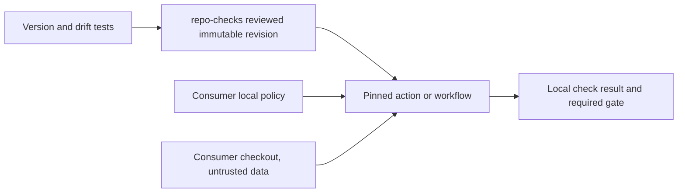

# Shared repository checks: proposed architecture

Status: design only, no new repository, consumer pin or workflow installed.
Companion `shared-checks-inventory.md` records live 24-repo source evidence and
checksums. This follows the request to run shared checks inside each repository,
not a central service with broad access to every repository.

## Inventory and first extraction

17 repositories have byte-identical scorecard_guard and its regression tests.
10 share identical run_summary; Ginot and WD have distinct variants. Layout
checker implementations differ, and only four repos have a tracked layout
contract today. The Geni placeholder scanner and parking-stats privacy scanner
have different privacy purposes and are not equivalent just because both scan
text. Their exact-tree policy and data minimization must remain local.

First share the exact Scorecard engine/tests, then common summary semantics with
explicit adapters for existing variants. Do not replace Ginot/WD summary behavior
with the oldest common copy. Next share a versioned layout engine, keeping each
repo's policy local. Privacy/placeholder extraction follows separate threat-model
review; never centralize private forbidden terms, baseline data or credentials.
No scanner extraction is permission to rebaseline or weaken a failing finding.

## Proposed repository and interface

Proposed name: `reihlinstinct/repo-checks` (availability not yet checked). Create
it only after design review, with normal standards/CI/license. Python standard
library core, typed CLI input schemas and testable pure checking functions.
Keep engines separate from a thin composite action and optional reusable workflow.
CLI returns stable exit codes and versioned value-free JSON: check ID, status,
rule ID, safe path/line and fixed explanation. No arbitrary payload logging.

Each consumer commits `.repo-checks.yml`: schema version, selected checks,
repository-local config paths, explicit exclusions with reasons, and engine
compatibility version. Existing layout manifests remain versioned source of
truth, not generated allow-everything baselines. Required filename/extension
policies are language-specific. Go root packages and Python build metadata need
explicit policy decisions, not a universal root-file ban.

The action receives only the current repository checkout and read-only token
where a check truly needs GitHub metadata. No organization-wide secret, write
permission or central copy of consumer data. Pull-request source is data, never
imported or executed by generic scanning. Disable submodule/hook execution and
validate paths, symlinks, input bounds and schema. A consumer's normal language
tests still run its code in the normal unprivileged CI boundary, separately.
Do not turn pull_request_target into secret-bearing execution of PR code.

## Supply chain and reproducibility

Consumers pin full immutable commit SHAs with a human version comment. Pin every
nested action as well. No mutable main/tag, curl-to-shell, runtime pip install or
implicit network fetch. A local offline CLI invocation is supported from a
verified cached copy when CI needs independence. Include engine source inventory,
release checksum, license and reproducible tests. Versions are semver; policy
schema changes and changed exit semantics are breaking. Security fixes use a
reviewed patch release and consumer update PRs, never a silently moved tag.

The reusable workflow checks out the caller's exact event commit, not its own
source tree by mistake. The action obtains its own engine from its pinned action
path; never accept a consumer override to substitute an engine into a privileged
context. No secrets in scanner CLI arguments, outputs, caches or artifacts.

## Drift and variant policy

Maintain a machine-readable registry of consumer SHA pins and adapter versions,
not private repository contents. An opt-in scheduled read-only drift check opens
nothing by itself: produce a value-free report, then a scoped maintainer PR can
update one consumer. Report missing/stale pins and unsupported schema separately
from check failures. Consumers retain their last reviewed version if upstream
is unavailable; no fallback to mutable latest or 'skip means pass'.

During transition run old and shared engines on the same synthetic/current tree
in shadow mode. Compare normalized outcomes, not just exit codes. Document and
test deliberate variant behavior. Delete a local copy only when equivalent
coverage, offline invocation and required CI context continuity are proven.
Keep repository-specific exclusions and release/admission rules outside shared
code. No central setting can disable a consumer's protection.

## Rollout plan, after design approval

1. Bootstrap repo-checks and exact common Scorecard engine/test vectors. Prove
   missing finding, increased-severity and result-redaction mutants are killed.
2. Pilot in collaboration-docs: old/shared parity, immutable pin, failure
   propagation and offline run. Its CONTRIBUTING requires another maintainer to
   merge the author's PR; retain that local rule.
3. Migrate common-summary consumers one PR each; preserve terminal/nonterminal,
   skipped and cancelled semantics; test WD/Ginot adapters independently.
4. Pilot shared layout engine in a repo already enforcing layout, then add
   accurate manifests/checker CI to missing repos in small waves. Do not mass
   move files, delete packaging entry points or reset baseline just to pass.
5. Separately review privacy-engine candidates and private-key custody. The
   public placeholder checker is not a certificate of no personal information.

Every step requires a focused issue/design as needed, exact-head independent
review, fresh green CI and normal signed merge, no bypass. Preserve required
check names while switching implementation, or coordinate explicit settings
approval separately. Report per-repo outcomes; design merge is not approval of
mass rollout or changes to held execution lanes.

## Acceptance

- Hermetic stdlib engine tests, real-tree failure tests and mutation checks.
- Untrusted configuration/code cannot execute commands or escape checkout.
- Broken/missing engine or policy fails a required gate; no secret or data leak.
- Pin/version/drift tests and an ordinary reviewed rollback to the old SHA.
- Exact old/shared parity on first pilot and adapters before local copy removal.
- No network, account, deployment, payment, live Geni or filing side effects.

Related work: existing OpenSSF-style checker request; this proposal provides
shared execution/custody/versioning, not an assertion that a custom checker
replaces OpenSSF Scorecard's own independent checks.
